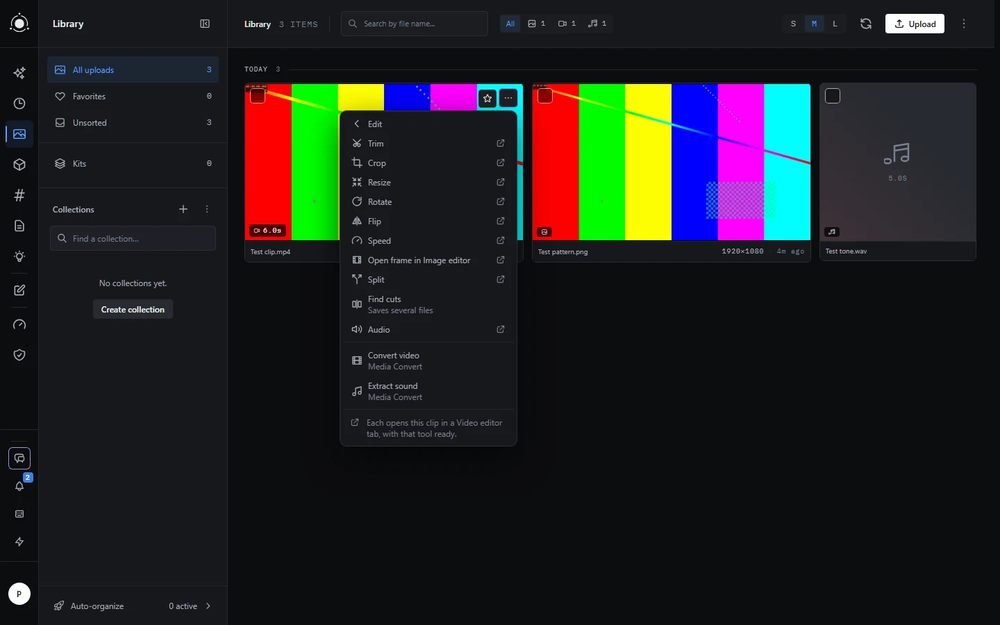
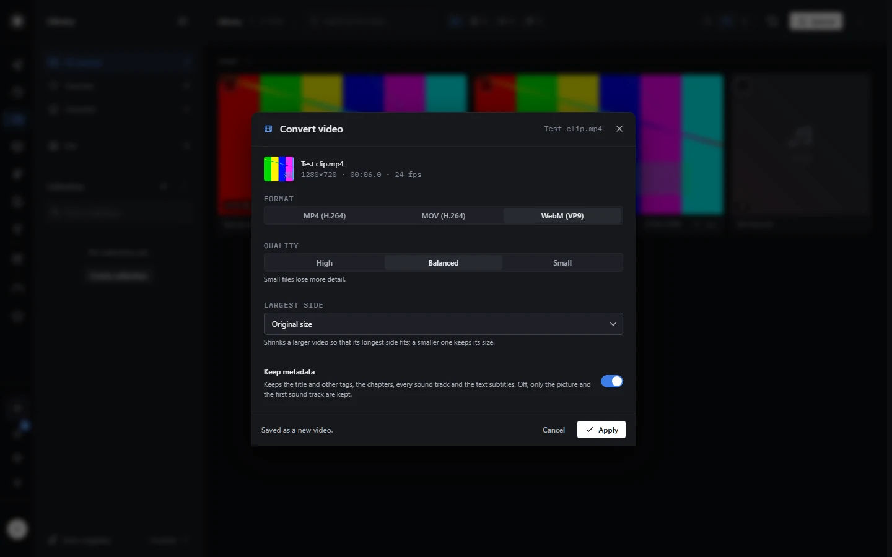
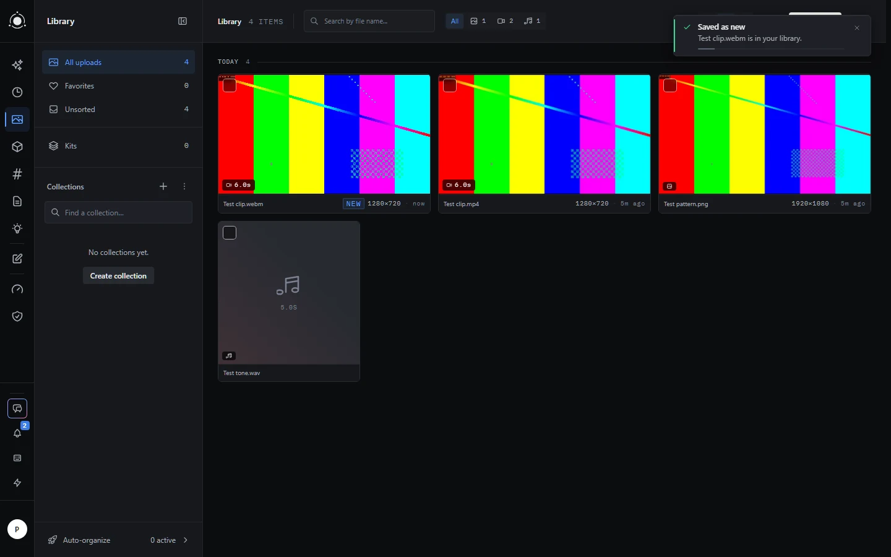

# Media Converter

Media Converter adds four tools to the **Tools** menu of the Library and of the History in PotionUI, for every user: convert an image, a video or a sound to another format, and extract the sound of a video.

Version 0.1.1. It needs PotionUI 0.2.0 or later. Install it from the catalogue of this repository:

```text
https://raw.githubusercontent.com/M4-S4/potionui-plugins/main/plugins.json
```

1. In **Admin › Plugins**, click **Install from catalog**, paste the catalogue URL and click **Read catalog**.
2. Click **Install** next to **Media Converter**.
3. Enable it. Its tools appear in the Tools menus at once.

Unless the notes of a version say otherwise, restart PotionUI after an update from the catalogue.

Updating from 0.1.0 to 0.1.1 needs its own order: disable Media Converter in **Admin › Plugins**, restart PotionUI, update it from the catalogue, then enable it. Tried in another order, the tools of 0.1.1 did not load: the update or the enabling ended with an error, and Media Converter stayed on 0.1.0 or without its tools. If that happens, start again from the first step, and skip the update step if the catalogue already shows 0.1.1 installed.



## What it needs on the server

ffmpeg and ffprobe, which the PotionUI image ships, and nothing else. Conversions run on the server's processor and never use the graphics card, so a generation keeps the whole card; a long video still takes the processor for a while and slows down the preparation of a generation that starts meanwhile.

In **Admin › Plugins › Media Converter**, an admin sets the number of ffmpeg threads per conversion (4 by default, from 1 to 16) and the longest video or sound a user may convert (30 minutes by default, from 1 to 30). Any signed-in user can run the tools. To turn them off for everyone, disable the plugin.

## Using it

The tools sit under **Edit**, where the menu names them with "Media Convert" below each tool:

| Tool | Takes | Makes |
|---|---|---|
| **Convert image** | an image | PNG, JPEG or WebP |
| **Convert video** | a video | MP4 (H.264), MOV (H.264) or WebM (VP9) |
| **Convert sound** | a sound | WAV, MP3, FLAC, M4A (AAC) or OGG (Opus) |
| **Extract sound** | a video with sound | WAV, MP3, FLAC, M4A (AAC) or OGG (Opus) |

The plugin has no page of its own: each tool opens the usual tool window of PotionUI, filled with the values you used last. Every tool has three quality steps (High, Balanced, Small) and a **Keep metadata** switch; Convert image and Convert video can also shrink the result to a largest side from 3840 down to 640 px.

The result is a new item in the Library, next to the original, which stays as it was. It keeps the name of the original with the extension of the new format: `Cat.png` converted to WebP becomes `Cat.webp`. A file of a generation keeps the name it has in the History. Select several items and run a tool once to convert them all in one run; if one of them is refused, the whole run fails and none of them is saved. Two sources with the same name, such as `Cat.png` and `Cat.webp` converted to JPEG, give two items both named `Cat.jpg`.

The tool window always saves a new item and never offers to replace the original. A request from the chat, the automation or the API can still ask PotionUI to replace an image, a video or a sound by its conversion; the item then keeps its old name and extension over the new content (`Cat.png` holding a WebP picture), which a download or a zip export of the Library carries along. The chat asks before it replaces anything: answer no and ask for a new item instead.





**Keep metadata** is on by default. Turn it off before you share a photo or a video taken with a phone: the place where it was taken is kept otherwise.

Every setting, the encoder behind each quality step, what each conversion keeps and loses, every refusal with its message and the load on the server are in the [reference](docs/reference.md), which PotionUI also shows in **Admin › Documentation** as "Media Converter: reference".

## Limits worth knowing

- Still images only: animated GIF and WebP are refused, and an SVG cannot be read.
- Images up to 67 million pixels (8192 × 8192), videos up to 4096 × 2304 (4K): larger ones are refused.
- A video comes out in 8-bit SDR colour: HDR and 10-bit sources lose their range, without tone mapping.
- A result that would be too large for one conversion (4 GB at most), one run (8 GB), the user's storage or the disk is refused. Media Converter keeps 2 GB free on the disk where PotionUI keeps its working files: a safeguard, not a guarantee that the disk never fills.
- A run from chat is cancelled after ten minutes and an automation node waits five minutes by default, so convert long videos from the Library.
- Not in this version: GIF or animated WebP made from a video, a target file size, H.265, AV1, AVIF, HEIC, JPEG XL, copying a stream without encoding it again, cover art of a sound file, and the tool in the media field of a generation form. The [reference](docs/reference.md#not-in-this-version) has the full list.

## Changes

### What changed in 0.1.1

- **The disk reserve counts the conversions still running.** Media Converter keeps 2 GB free on the disk where PotionUI keeps its working files. In 0.1.0 each conversion got half of the space that was free above these 2 GB when it started, so conversions that overlapped could together take more than that. In 0.1.1 the room given to every conversion still running, less what it has already written, is taken out of the free space before a new conversion gets its share. The reserve covers the conversions of Media Converter only, counted in the PotionUI process that runs them; a video or sound conversion can still write past its room before ffmpeg stops, by about one encoded frame and the end of the file.
- **A JPEG at High quality from a very detailed image.** Such an image could fail with a general error in 0.1.0. It is now written a second time without Huffman optimisation, which gives a slightly larger file of the same quality.
- **The server log on a lack of disk space.** When Media Converter refuses a conversion for lack of disk space, the server log also gives the room promised to the conversions still running.

### What changed in 0.1.0

- **First version.** Four tools in the Tools menu of the Library and the History: Convert image saves an image as PNG, JPEG or WebP; Convert video saves a video as MP4 or MOV in H.264, or as WebM in VP9; Convert sound saves a sound as WAV, MP3, FLAC, M4A (AAC) or OGG (Opus); Extract sound saves the sound of a video in the same five formats.
- **Settings of each tool.** Three quality steps (High, Balanced, Small) and a Keep metadata switch; Convert image and Convert video can also make the result smaller, with a largest side from 3840 px down to 640 px.
- **Admin settings.** The number of ffmpeg threads per conversion, and the longest video or sound a user may convert, 30 minutes at most.
- **Bounds.** Images over 67 million pixels and videos over 4096 × 2304 are refused. One conversion writes at most 4 GB and one run at most 8 GB. Media Converter refuses to convert when less than 2 GB are free on the disk where PotionUI keeps its working files.

## License

GPL-3.0, like the other plugins of this repository; the text is in the [LICENSE](https://github.com/M4-S4/potionui-plugins/blob/main/LICENSE) of the repository.
