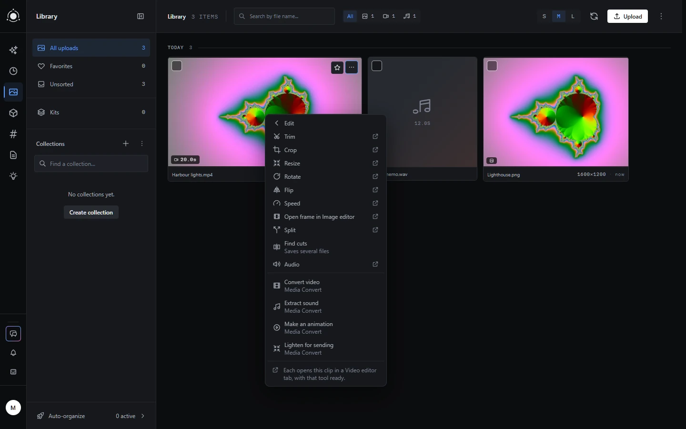
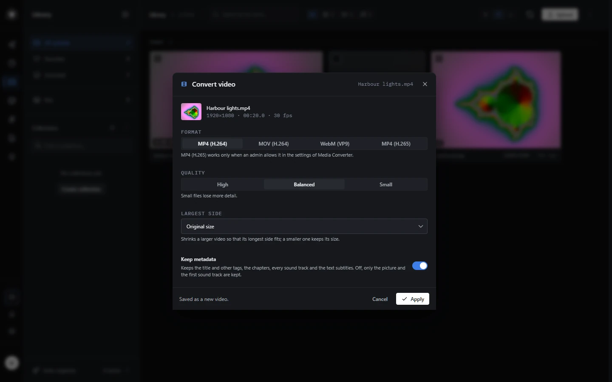
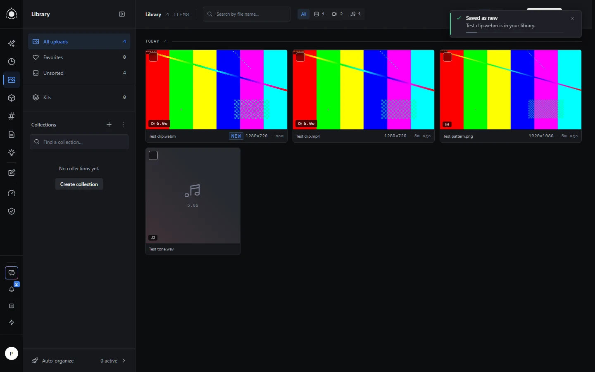

# Media Converter

Media Converter adds six tools to the **Tools** menu of the Library and of the History in PotionUI, for every user: convert an image, a video or a sound to another format, extract the sound of a video, make a looping GIF or animated WebP from a video, and lighten a video under a size you choose before you send it. Install it from this catalogue:
```text
https://raw.githubusercontent.com/M4-S4/potionui-plugins/main/plugins.json
```

Version 0.2.0. It needs PotionUI 0.2.0 or later.

1. In **Admin › Plugins**, click **Install from catalog**, paste the catalogue URL and click **Read catalog**.
2. Click **Install** next to **Media Converter**, then **Install** in the window that asks to confirm. It arrives in the list, disabled.
3. Turn it on with its switch. Its tools appear in the Tools menus at once.

Updating from 0.1.0 or 0.1.1 to 0.2.0 needs its own order: disable Media Converter in **Admin › Plugins**, restart PotionUI, update it from the catalogue, then enable it. Tried in another order, the tools of the new version may not load: the update or the enabling ends with an error, and Media Converter stays on its old version or without its tools. If that happens, start again from the first step, and skip the update step if the catalogue already shows 0.2.0 installed.



## What it needs on the server

ffmpeg and ffprobe, which the PotionUI image ships, and nothing else. Conversions run on the server's processor and never use the graphics card, so a generation keeps the whole card; a long video still takes the processor for a while and slows down the preparation of a generation that starts meanwhile.

In **Admin › Plugins › Media Converter › Settings**, an admin sets the number of ffmpeg threads per conversion (4 by default, from 1 to 16), the longest video or sound a user may convert (30 minutes by default, from 1 to 30), and whether Convert video may write MP4 (H.265), which is off by default. Any signed-in user can run the tools. To turn them off for everyone, disable the plugin.

## Using it

The tools sit under **Edit**, where the menu names them with "Media Convert" below each tool:

| Tool | Takes | Makes |
|---|---|---|
| **Convert image** | an image | PNG, JPEG or WebP |
| **Convert video** | a video | MP4 (H.264), MOV (H.264), WebM (VP9), or MP4 (H.265) when an admin allows it |
| **Convert sound** | a sound | WAV, MP3, FLAC, M4A (AAC) or OGG (Opus) |
| **Extract sound** | a video with sound | WAV, MP3, FLAC, M4A (AAC) or OGG (Opus) |
| **Make an animation** | a video | a looping GIF or animated WebP of 30 seconds at most |
| **Lighten for sending** | a video | an MP4 (H.264) under 8, 16, 18, 20, 30 or 50 MB |

The plugin has no page of its own: each tool opens the usual tool window of PotionUI, filled with the values you used last. The conversion tools have three quality steps (High, Balanced, Small), hidden for the lossless PNG, WAV and FLAC, and a **Keep metadata** switch; Convert image and Convert video can also shrink the result to a largest side from 3840 down to 640 px.

The result is a new item in the Library, next to the original, which stays as it was. It keeps the name of the original with the extension of the new format: `Cat.png` converted to WebP becomes `Cat.webp`. A file of a generation keeps the name it has in the History. Select several items and run a tool once to convert them all in one run; if one of them is refused, the whole run fails and none of them is saved. Two sources with the same name, such as `Cat.png` and `Cat.webp` converted to JPEG, give two items both named `Cat.jpg`.

The tool window always saves a new item and never offers to replace the original. A request from the chat, the automation or the API can still ask to replace an image, a video or a sound by its conversion. The replaced item can then keep its old name and extension over the new content, such as `Cat.png` holding a WebP picture, and a download or a zip export of the Library carries that name along.





**Keep metadata** is on by default in the four conversion tools. Turn it off before you share a photo or a video taken with a phone: the place where it was taken is kept otherwise. In **Lighten for sending** it is off by default.

### Make an animation

Pick the format, where the animation starts in the video, how long it lasts (10 seconds by default, from half a second to 30), its largest side (640, 480 or 320 px, never larger than the video), its frame rate and its quality. The result is an image item, `Clip.gif` or `Clip.webp`, that loops forever.

- A GIF plays everywhere but grows fast with grain and movement: in our tests, 16 seconds of grainy footage at 640 px made a GIF of 47 MB, and 15 seconds at 320 px and Half one of 5 MB. An animated WebP plays in current browsers and weighed 2 to 16 times less than the GIF in our tests, the most on grainy footage. For a light GIF, pick 320 px, Half or A third.
- The frame rate is the video's own, divided by the smallest whole number that brings it to 25 per second or less, and the other two steps keep every second or every third frame of that: a 16 fps clip gives 16, 8 or about 5 frames per second, a 30 fps clip 15, 7.5 or 5. The motion stays even.
- A GIF of 15 seconds at 480 px and 24 frames per second weighed about 5 MB in our tests; the same in WebP about 2 MB.
- When the end of the clip and its start do not match, the loop jumps where it starts again: pick a start and a length that close the loop.

### Lighten for sending

Pick the largest size the file may weigh: 8 MB, 16 MB (the default), 18, 20, 30 or 50 MB, counted in millions of bytes. The result is an MP4 in H.264 with AAC sound, a format that most phones, computers and browsers play, below that size.

- Media Converter works out the bitrate from the length of what it keeps (the picture, and the sound when Keep the sound is on), keeps 4 % of the size as a margin, and encodes the picture in two passes so that the size is met closely. When the size is tight, the picture is made smaller, down to 480 px on its longest side, and the sound goes down from 128 to 96 or 64 kbit/s, never above the sound of the source.
- The file written is measured. If it reaches the size anyway, the second pass is done once more with less bitrate; if it still reaches it, the tool refuses with "Media Converter could not bring this video under 16 MB; choose a larger size", and nothing is added to the Library.
- A size too small for the length of the video is refused before anything is encoded, with the smallest size that would work, such as "This video lasts 10 minutes: to fit in 8 MB, its picture would be too poor to watch. The smallest file Media Converter can make from it weighs about 17 MB; choose 18 MB or more".
- An MP4 or MOV that is already under the size, with an H.264 picture in 8-bit 4:2:0 and AAC sound in mono or stereo, or no sound, is copied without being encoded again. Another video already under the size is encoded again: with an H.264 picture, it aims at its own weight less 4 % and came out lighter than it was in our tests; in another format, such as H.265 from a phone or VP9, it can come out up to one and a half times heavier than it was, so that it plays everywhere.
- Only the result counts against your storage and against the largest file your plan allows. When that largest file is smaller than the size you picked, the tool says which size to pick, such as "Your files may weigh at most 20 MB; choose 20 MB or less".
- **Keep the sound** is on by default; off, the result has no sound and the picture gets the room. **Keep metadata** is off by default: the title, the tags and the place where the video was filmed are left out. Only the picture and the first sound track are kept, mixed down to stereo.

In our tests, a 60-second video in 1080p came out at 7.7 MB for 8 MB and 15.4 MB for 16 MB, both in 720p, and at 28.9 MB for 30 MB in 1080p, each in 8 to 18 seconds on a desktop processor.

### MP4 (H.265)

MP4 (H.265) stays in the format list of Convert video even while an admin has not allowed it; it is then refused with "MP4 (H.265) is turned off on this server: an admin can allow it in Admin › Plugins › Media Converter › Settings. Choose MP4 (H.264) meanwhile".

- The file is tagged `hvc1`, which Apple devices need to play it. Whether an H.265 video plays depends on the browser and the device: some browsers and systems play it only with hardware that decodes H.265 or an extra codec, so the item may not play in the Library on every computer.
- H.265 makes lighter files than H.264 at a similar quality, but it took two to five times as long to encode in our tests. The thread setting bounds the thread pool of the H.265 encoder like the other encoders.
- Before it encodes a video that may take long, Media Converter times the encoding of three short parts of it, at a quarter, half and three quarters of its length, and refuses the video if the whole would take more than about 18 minutes at the pace of the slowest part, with "MP4 (H.265) would take about N minutes to encode this video on this server, more than a conversion may take; choose a smaller Largest side, MP4 (H.264), or a shorter video". It is an estimate: a video much heavier elsewhere than in these three parts can still take longer.
- H.265 is covered by patents that are licensed through patent pools. Check whether they concern your use before you allow it.

Every setting, the encoder behind each quality step, what each conversion keeps and loses, every refusal with its message and the load on the server are in the [reference](docs/reference.md), which PotionUI also shows in **Admin › Documentation** as "Media Converter: reference".

## Limits worth knowing

- Convert image takes still images only: animated GIF and WebP are refused, and an SVG cannot be read.
- Images up to 67 million pixels (8192 × 8192), videos up to about 9.4 million pixels (4096 × 2304, which covers 4K): larger ones are refused.
- A video comes out in 8-bit colour. An HDR video, such as one filmed by a recent phone, keeps its HDR colour labels over 8-bit pictures, without tone mapping: depending on the player it can show colour bands, or look washed out in a player that ignores the labels.
- A result that would be too large for one conversion (4 GB at most), one run (8 GB), the user's storage or the disk is refused. Media Converter keeps 2 GB free on the disk where PotionUI keeps its working files: a safeguard, not a guarantee that the disk never fills.
- Start long video conversions from the Library: the chat and the automation may stop waiting for a long conversion before it ends.
- Not in this version: an animation made back into a video, Lighten for images, replacing the original from the tool window, AV1, AVIF, HEIC, JPEG XL, copying a stream without encoding it again outside Lighten for sending, cover art of a sound file, and the tool in the media field of a generation form. The [reference](docs/reference.md#not-in-this-version) has the full list.

## Changes

### What changed in 0.2.0

- **Make an animation.** A new tool makes a looping GIF or animated WebP of up to 30 seconds from a video, with a start, a length, a largest side of 640, 480 or 320 px, three frame rates that divide the video's own, and three quality steps.
- **Lighten for sending.** A new tool makes an MP4 in H.264 under 8, 16, 18, 20, 30 or 50 MB, in two passes, with a check of the file written and one more try when it is too heavy. A size too small for the video is refused with the smallest size that works, and a video already under the size in MP4 or MOV, with an 8-bit 4:2:0 H.264 picture and AAC sound in mono or stereo, is copied without being encoded again. Keep metadata is off by default in this tool.
- **MP4 (H.265) in Convert video**, behind a new admin setting that is off by default. The file is tagged `hvc1`, the thread setting bounds the encoder, and a video that a trial on three short parts of it shows to be too long to encode is refused before the encoding starts.

### What changed in 0.1.1

- **The disk reserve counts the conversions still running.** Media Converter keeps 2 GB free on the disk where PotionUI keeps its working files. In 0.1.0 each conversion got half of the space that was free above these 2 GB when it started, so conversions that overlapped could together take more than that. In 0.1.1 the room given to every conversion still running, less what it has already written, is taken out of the free space before a new conversion gets its share. The reserve covers the conversions of Media Converter only; a video or sound conversion can still write past its room before ffmpeg stops, by about one encoded frame and the end of the file.
- **A JPEG at High quality from a very detailed image.** Such an image could fail with a general error in 0.1.0. It is now written a second time without Huffman optimisation, which gives a slightly larger file of the same quality.
- **The server log on a lack of disk space.** When Media Converter refuses a conversion for lack of disk space, the server log also gives the room promised to the conversions still running.

### What changed in 0.1.0

- **First version.** Four tools in the Tools menu of the Library and the History: Convert image saves an image as PNG, JPEG or WebP; Convert video saves a video as MP4 or MOV in H.264, or as WebM in VP9; Convert sound saves a sound as WAV, MP3, FLAC, M4A (AAC) or OGG (Opus); Extract sound saves the sound of a video in the same five formats.
- **Settings of each tool.** Three quality steps (High, Balanced, Small) for the lossy formats and a Keep metadata switch; Convert image and Convert video can also make the result smaller, with a largest side from 3840 px down to 640 px.
- **Admin settings.** The number of ffmpeg threads per conversion, and the longest video or sound a user may convert, 30 minutes at most.
- **Bounds.** Images over 67 million pixels and videos over about 9.4 million pixels (4096 × 2304) are refused. One conversion writes at most 4 GB and one run at most 8 GB. Media Converter refuses to convert when less than 2 GB are free on the disk where PotionUI keeps its working files.

## License

GPL-3.0, like the other plugins of this repository; the text is in the [LICENSE](https://github.com/M4-S4/potionui-plugins/blob/main/LICENSE) of the repository.
