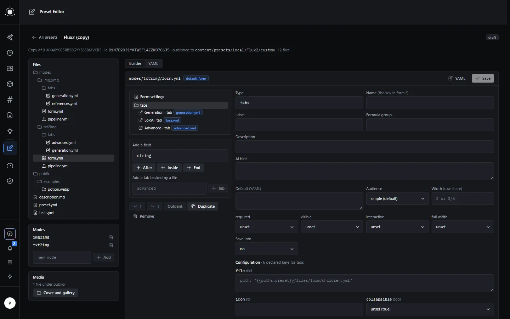
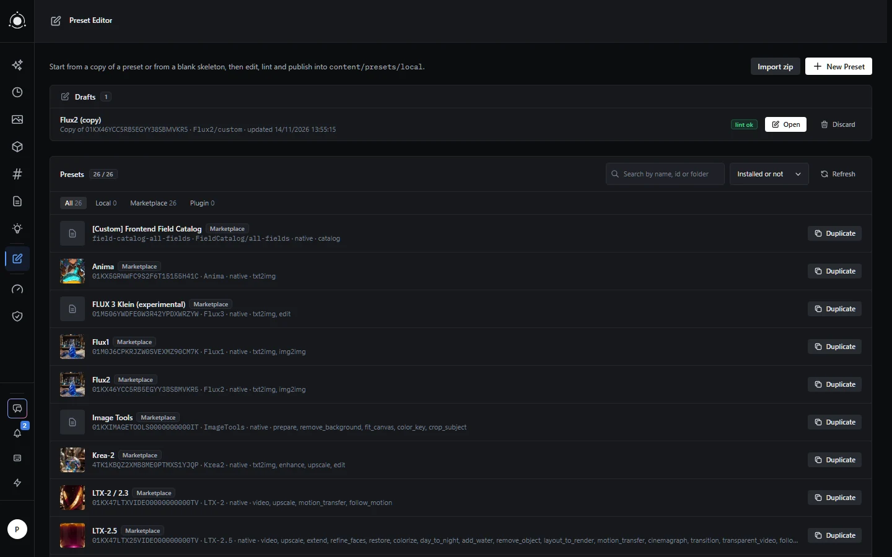
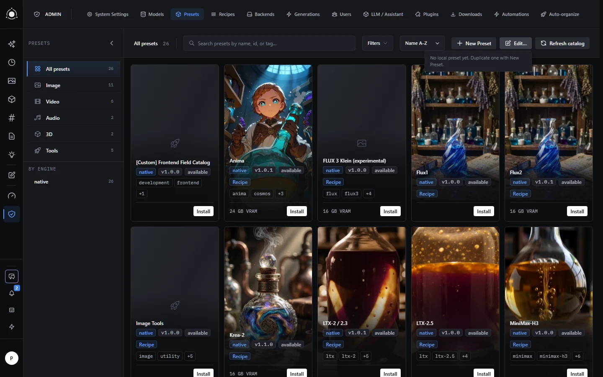
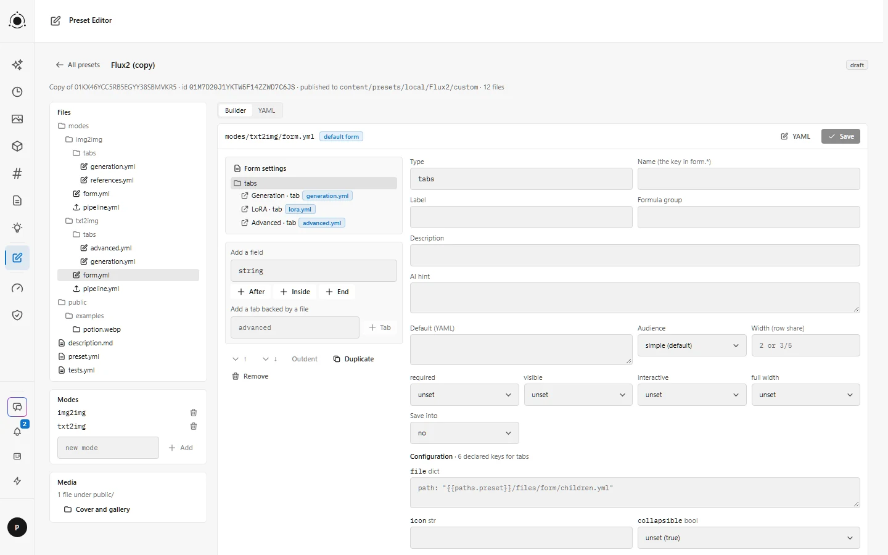

# Preset Editor

Create, edit, check and publish presets without leaving PotionUI, for admins only. Install it from this catalogue:
```text
https://raw.githubusercontent.com/M4-S4/potionui-plugins/main/plugins.json
```

Version 0.2.5. It runs on PotionUI 0.1.0 or later; the catalogue needs PotionUI 0.2.0 or later, whose **Admin › Plugins** page shows **Install from catalog**.

1. In **Admin › Plugins**, click **Install from catalog**, paste the catalogue URL and click **Read catalog**.
2. Click **Install** next to **Preset Editor**, then **Install** in the window that asks to confirm. It arrives in the list, disabled.
3. Turn it on with its switch.

Without the catalogue, on PotionUI 0.1.0 for example, install it by hand from its release zip, as the [README of the repository](https://github.com/M4-S4/potionui-plugins#install-by-hand) says.

To update from 0.2.4 to 0.2.5, disable Preset Editor in **Admin › Plugins**, restart PotionUI, update it from the catalogue, then enable it. An update started while 0.2.4 is enabled is refused with the message that 0.2.5 did not start, and 0.2.4 stays in place; restarting and updating again gives the same refusal.



## What it needs on the server

Nothing else: the plugin needs no setting to work and keeps no database table. Drafts and the history are folders under `storage/plugins/preset-editor/`, which are not part of the core backup. Published presets go to `content/presets/local/`: in Docker, mount that folder as a volume, or a published preset vanishes when the container is recreated. Its routes are for a signed-in admin only; no API key reaches them.

## What you can do

Two things appear, for admins only: a **Preset Editor** entry in the sidebar (the page `/plugins/preset-editor`) and, in the header of **Admin › Presets**, the buttons **New Preset** and **Edit…**.

- **New Preset** copies a preset of the catalogue or starts from a blank skeleton, as a draft that publishes to `content/presets/local/<Model>/<variant>`; **Edit…** opens a local preset as a draft.
- The draft workbench edits every file of the preset: `preset.yml` as a form, `form.yml`, its tabs and fragments in a form builder, `pipeline.yml` in a pipeline builder, any file in a text editor, and the cover and gallery in the Media view, with a preview of `description.md` as **Admin › Presets** shows it.
- A draft shows the report of PotionUI's own preset linter. **Publish** needs a report without errors, writes the preset, reloads the catalogue without a restart and checks that PotionUI loads it; when the loader refuses it, the previous state is put back.
- **History** keeps the versions replaced or deleted, and **Restore** opens one as a draft. **Download zip** and **Import zip** move a preset folder in and out as an archive.





The page follows the light theme of PotionUI as well:



Every option, check and setting is in the [reference](docs/reference.md), which PotionUI also shows in **Admin › Documentation** as "Preset Editor: reference".

## Limits worth knowing

- The form and pipeline builders rewrite the whole file they save: comments and the original formatting go away. The YAML view keeps them.
- The form preview and the rendered pipeline exist only for a published version.
- The linter does not check field types: a preset that lints clean but uses a `type:` the loader refuses is rolled back at publish time, with the loader's messages.
- Media uploads are capped at 20 MB, with PotionUI's own extensions only (no SVG).

The [reference](docs/reference.md#limits-worth-knowing) lists them all. What is left to do and how to run the tests are in [docs/development.md](https://github.com/M4-S4/potionui-plugins/blob/main/preset-editor/docs/development.md).

## Changes

The details of each version are in [docs/development.md](https://github.com/M4-S4/potionui-plugins/blob/main/preset-editor/docs/development.md#changes-in-detail).

### What changed in 0.2.5

- Modes whose `pipeline.yml` is the single line `pipeline_from: <mode>` (PotionUI 0.2.0) open read-only, and saving no longer breaks them.
- A mode that another mode names with `pipeline_from:` cannot be removed.
- The description preview follows the link rule of PotionUI 0.2.0, as **Admin › Presets** does.
- No route of the plugin accepts an API key; a signed-in admin works as before.

### What changed in 0.2.4

- The preset list marks a preset mirror with a *mirror* pill; the list and the Edit… menu no longer offer to edit, export or delete it or show its history, and Duplicate copies its source.

### What changed in 0.2.3

- Preset Editor refuses to delete, edit or export a preset mirror, or to publish a draft under its id; in 0.2.2, deleting a mirror of a local preset removed the folder of its source.
- Deleting a local preset checks its folder and its id first.
- A version from the history is restored under the id its `preset.yml` declares; a source folder removed with a mirror in 0.2.2 can be put back from the history.
- An edit draft takes the name written in `preset.yml`.

### What changed in 0.2.2

- The preview of `description.md` is rendered like **Admin › Presets**: line breaks, headings, GFM tables and relative links.

### What changed in 0.2.1

- The description preview shows an image line as text, as **Admin › Presets** does.
- The buttons in **Admin › Presets** take the size of the host's, and the zip of a local preset shows its download.
- In the form builder, a value being typed is no longer lost or written into another node when you click the tree.

### What changed in 0.2.0

- The builders know the keys of today's presets: prompt settings, requirements, segment templates, includes with vars, formula groups and anchors.
- Adding a mode suggests the mode names the core knows; removing a mode is refused while another mode loads its files.
- Every request goes through the host's authenticated client.
- The plugin renders on an instance whose frontend was built without it.

## License

GPL-3.0, like the other plugins of this repository; the text is in the [LICENSE](https://github.com/M4-S4/potionui-plugins/blob/main/LICENSE) of the repository.
