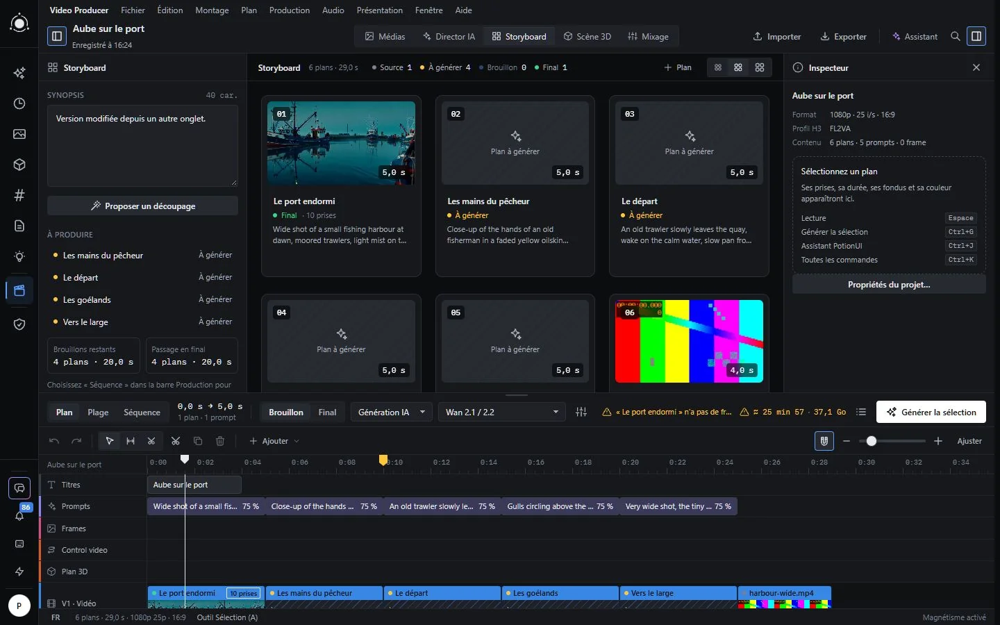
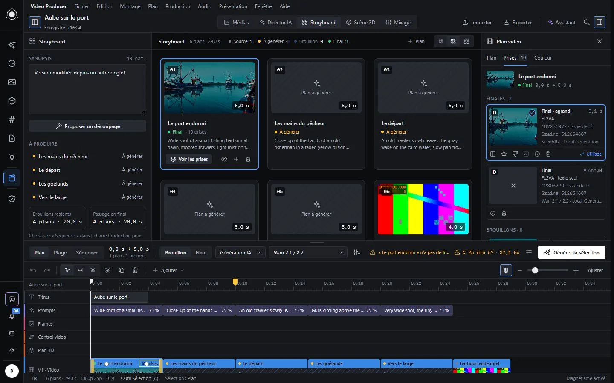
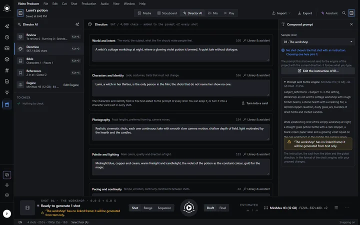

# Video Producer

A page of PotionUI where your users make short films with AI video, from the synopsis to the exported film: shots, takes, editing, color and sound. Install it from this catalogue:
```text
https://raw.githubusercontent.com/M4-S4/potionui-plugins/main/plugins.json
```

Version 0.7.1. It needs PotionUI 0.2.0 or later. This page is for the administrator; users read **Video Producer: user guide**.

1. In **Admin › Plugins**, click **Install from catalog**, paste the catalogue URL and click **Read catalog**.
2. Click **Install** next to **Video Producer**, then **Install** in the window that asks to confirm. It arrives in the list, disabled.
3. Turn it on with its switch. **Video Producer** appears in the sidebar of every user, and **Setup needed** shows until the setup steps are done.

To install it by hand, see the [README of the repository](https://github.com/M4-S4/potionui-plugins#install-by-hand); the catalogue does not update such an install.



## What it needs on the server

The plugin's **Overview** tab, in **Admin › Plugins**, checks six setup steps and links to the page that fixes each:

| Setup step | What to do |
|---|---|
| Enable a native backend or a cloud video model | In **Admin › Backends**: this machine (NVIDIA Turing or newer, driver 580 or newer), a PotionUI Remote Native worker, or a cloud backend with a video model. |
| Install and assign at least one Video Director preset | A video preset: see Getting started. |
| Install SeedVR2 for final takes | Run **SeedVR2 Starter** in **Admin › Recipes**, then assign SeedVR2. It can wait for a first film. |
| Give Video Producer a writable work folder | See The work folder. |
| Install ffmpeg for video delivery | See ffmpeg. |
| If a MiniMax-H3 preset is installed, install its model files | Four files, five with an Upscale mode; the 12 GB recipes download theirs. |

A user sees only the presets assigned to them or their groups; you see them all. Also assign Video Tools or RTX Upscale, so that takes with fewer frames per second than the film play without repeated frames. The steps do not check the PotionUI version, the card's model and memory, or the assistant.

## Choose the presets

**MiniMax-H3 license.** The weights, Fast and VDN variants included, are published under the MiniMax H3 Community License, which is not an open-source license. The license says that its Applicable Territory excludes the European Union, the United Kingdom, the United States and the Republic of Korea, that the exclusion extends to what the model generates, and that use there needs an individual authorization from MiniMax (https://platform.minimax.io/h3-license).

The license also says that a separate written authorization is required above US$20M of annual revenue, and that a commercial product's interface must display "MiniMax H3" prominently. PotionUI ships no weights: the license is between you and MiniMax.

**Validation.** PotionUI's own documentation still lists the MiniMax-H3 family as not validated on real weights, and Video Producer does not change that status. Its 12 GB presets were measured on a 12 GB card.

**LTX-2.5 license.** LTX-2.5 and its IC-LoRAs (add-on weights) are published under the LTX-2.x Community License of Lightricks. The license says that below US$10M of annual revenue, the group counted, every use is allowed, commercial included, within its terms, and it asks that a video be said to be generated by AI where the law requires it. Read it before you install LTX-2.5.

More in the admin reference: **MiniMax-H3: read before enabling** and **LTX**.

Video Producer ships six presets for 8 GB and 12 GB cards, each with a recipe of the same name in **Admin › Recipes**.

### What to expect on an 8 GB or 12 GB card

| Card | Presets | System RAM | What the users get | A 5-second take at 832×480 |
|---|---|---|---|---|
| 8 GB | **Wan 2.1 T2V 1.3B (8 GB)**, **Wan 2.2 TI2V 5B (8 GB)** | 32 GB | 480p clips of up to 5 s; the 5B can start from a first frame. | about 5.5 and 4.5 min |
| 12 GB | **MiniMax-H3 (12 GB)**, **MiniMax-H3-Fast (12 GB)**: license above | 64 GB | Video with sound, up to 15 s; **MiniMax-H3 (12 GB)** also follows reference pictures (Ref2VA). | about 7.5 and 6 min |
| 12 GB | **Wan 2.2 14B Lightning (12 GB)** and its companion **Wan 2.2 14B Lightning I2V (12 GB)** | 64 GB | Fast text to video; image to video for shots that start from an image. | about 3.5 min; 2 min 15 s to 2 min 45 s |

Measured on an NVIDIA RTX 4070 Ti, limited to 8 GB for the 8 GB presets. A SeedVR2 upscale of such a take to 1080p takes about 2.5 hours. Set **Max generations in flight per user** and the GPU minutes of your plans accordingly. More under **Hardware** in the admin reference.

On the **Generate** page of PotionUI, a Video Director chain of the two MiniMax-H3 (12 GB) presets holds up to 12 shots, and 6 in the mode **References to Video** of MiniMax-H3 (12 GB). A chain of 12 shots of about 5 s at 832×480, from text alone, took about 35 min on **MiniMax-H3-Fast (12 GB)** and about 74 min on **MiniMax-H3 (12 GB)**, with the same time per shot as a chain of 6 to within 3 %. Longer shots, keyframes and a sound track given to such a chain were not measured. Such a chain is not a Video Producer take: it counts neither in **Max generations in flight per user** nor in the **Video Producer GPU minutes** of a plan.

Other video presets of PotionUI work too, more slowly when they are too large for the card.

## Getting started

A first film on a 12 GB card:

1. In **Admin › Recipes**, run **Wan 2.2 14B Lightning (12 GB)** (about 38 GB to download), then **Wan 2.2 14B Lightning I2V (12 GB)** (31 GB more).
2. A recipe assigns its preset to you only: assign both to your users or groups in **Admin › Presets**.
3. In the **Overview** tab, every step but SeedVR2 should now be done.
4. Open **Video Producer**: the starter project **Lumi’s potion** opens. Select shot 1 and click **Generate selection** (Ctrl+G): two drafts, about 7 minutes, more the first time the model loads.

The user guide walks through a whole film, from the starter project to the export.



### The work folder

Video Producer writes its exports and work files in `<file storage directory>/video_producer/`, which must be local and writable, even with object storage. Otherwise set a writable file storage directory in **Admin › Settings**, or mount one into the container.

### ffmpeg

Video Producer needs `ffmpeg` and `ffprobe` on the `PATH` of the PotionUI process to export a video and to start a shot from the last image of the previous one. The official PotionUI Docker image ships both; elsewhere, install them and restart PotionUI.

### Limits worth knowing

- **Wan 2.2 14B Lightning I2V (12 GB)**: install it with its own recipe, not with the **Install** button of a mode (see the setup notes).
- **One export at a time** for the whole server; the others wait as Queued.
- **The assistant** (chat mode **Video Producer assistant**) needs a language model that calls tools, assigned to your users.
- The admin reference has the rest: [Settings](docs/admin-reference.md#settings), [Quotas](docs/admin-reference.md#quotas), [Engines](docs/admin-reference.md#engines), [SeedVR2 for finals](docs/admin-reference.md#seedvr2-for-finals), [RTX Upscale for finals](docs/admin-reference.md#rtx-upscale-for-finals), [The assistant mode](docs/admin-reference.md#the-assistant-mode) and [Troubleshooting](docs/admin-reference.md#troubleshooting).

Pages in **Admin › Documentation**: [setup notes](docs/setup.md), [admin reference](docs/admin-reference.md), [user guide](docs/user-guide.md) (users see it too), [complete reference](docs/user-reference.md), [technical reference](docs/technical-reference.md).



## Changes

The full notes of each version are on the [releases page](https://github.com/M4-S4/potionui-plugins/releases).

### What changed in 0.7.1

- When the engine makes the takes of a shot in another ratio than the film, for example 832×480 drafts of a 2.39:1 film, the start and end image thumbnails show the part that take keeps, in its ratio, instead of the frame of the film: in the Inspector, the shot editor and the shot quick edit, where an empty box takes that ratio too, and in the seam monitor and review. A picture already in the ratio of the take, within 3 %, is shown whole.
- The thumbnails follow the take the production deck would make now, Draft or Final, and show the frame of the film until the deck has estimated such a take.
- In the review of a take, the seams no longer have a fixed 16:9 box: a take shows in the frame of the film, and a start or end image like the thumbnails above.
- Past 30 %, the crop warning asks for a start or end image in the frame of the take instead of the film.
- The user guide is rewritten as one chapter per step of the work, at about half its length, with nine dark screenshots.
- The admin, complete and technical references open with a table of contents and repeat themselves less.
- In **Admin › Documentation**, the headings and lists of the guide and of the three references show as such, and the nine screenshots of the guide show as links, not as pictures.
- Nothing changes in the crop, the takes, the projects or the tables: with the same seed, a new take is the one 0.7.0 makes.

### What changed in 0.7.0

- A start or end image, the last image of the previous shot a take starts from or the first frame a guided final takes from its draft, when it is in another ratio than the take, is cropped at its centre before it goes to the engine, cloud engines included, so MiniMax-H3 no longer stretches it. An image a crop would cut by 3 % or less is sent as before.
- A phone photo taken sideways is sent the right way up, as an upright copy.
- A new take of a shot with such an image is therefore not the take 0.6.1 made, even with the same seed.
- Each crop or upright copy is stored in the library of the project's owner, as `<picture>-crop-<width>x<height>` or `<picture>-upright-<width>x<height>`; it counts in that owner's storage and stays when the project or the picture is deleted.
- Before a take starts, the deck says how much of such an image is cut; past 30 % it asks for an image in the frame of the film and, when nothing blocks the generation, offers **Make a start image** or **Make an end image**.
- When the crop cannot be made or stored, for example because the storage of the project's owner is full, the take goes with the original picture, which may come out stretched in the take, depending on the engine and the version of PotionUI, and its card says **Not cropped**, with the reason in its tooltip.
- The start and end image thumbnails and the seam frames show the picture in the frame of the film.
- The descriptions of **MiniMax-H3 (12 GB)** and **MiniMax-H3-Fast (12 GB)** use the labels PotionUI shows, and the note of the OpenTimelineIO export no longer names products.
- For admins: a new table, `video_producer_frame_crops`, and a new column, `frame_notes`, on `video_producer_takes`, both made at boot or when the plugin is enabled.

### What changed in 0.6.1

- On the **Generate** page of PotionUI, a Video Director chain of **MiniMax-H3 (12 GB)** or **MiniMax-H3-Fast (12 GB)** holds up to 12 shots instead of 6, in the mode **Video Director** of the first and **Video** of the second; the mode **References to Video** of MiniMax-H3 (12 GB) stays at 6. Video Producer projects do not change: the plugin sends one shot per generation.
- New page in **Admin › Documentation**, **Video Producer: setup notes**: how to install Wan 2.2 14B Lightning I2V (12 GB) with its own recipe, and how to install the plugin by hand.

### What changed in 0.6.0

- **From a kit**: wherever Video Producer imports or chooses a media, a **From a kit** button opens your PotionUI kits; each item taken becomes an ordinary media of the project, which no longer follows the kit.
- The two MiniMax-H3 (12 GB) presets follow those of PotionUI 0.2.0, with no change of default or render; **MiniMax-H3 (12 GB)** gains a **Colour hold** setting, at 0.
- The generation summary window, which nothing opened any more, is gone.
- Needs PotionUI 0.2.0 or later; on an earlier PotionUI, stay on Video Producer 0.5.2.

### What changed in 0.5.2

- When the assistant or another window changes a project with cross-dissolves while you edit it, the dissolves keep playing, and every prompt and keyframe stays in place.

### What changed in 0.5.1

- In a project without a cross-dissolve, the export no longer puts a black frame after a shot of an odd length, such as a 3.1 s video, and the shots stay in step with the music and the subtitles.
- A shot split with the blade plays on with no repeated or skipped frame, and the exchange files for other editing software follow the video.
- The export of some projects changes, and the first edit of a project made with an earlier version can move a shot 0.04 s later.

### What changed in 0.5.0

- **Cross-dissolve** between two shots, of 0.4, 0.6, 1, 1.2 or 2 seconds, chosen under **Transition** in the Inspector; the film gets shorter by its length.
- A project with a cross-dissolve does not open with Video Producer 0.4.0 or older.

### What changed in 0.4.0

- **Finishing** at export: Fix colours, a LUT, a Look, a Vignette and Film grain on a web or social export, saved as a new video; the master and the archive are never finished.
- **Write the prompt**: the language model of PotionUI proposes the prompt of a shot; nothing changes until **Use this prompt**.
- **MiniMax-H3-Fast (12 GB)** now continues the previous take of a shot chained by **Continuation** in FL2VA (the profile made from frames and text), about 23 % slower; set **Chain by** to **Last frame** to keep the old behaviour.
- With MiniMax-H3 in Ref2VA, a shot can set its own **Card words beside a picture**.

### What changed in 0.3.2

- Only **MiniMax-H3 (12 GB)** continues an FL2VA shot chained by continuation; the MiniMax-H3 presets of PotionUI start it from the last frame again, instead of replaying the end of the previous shot.

### What changed in 0.3.1

- The MiniMax-H3 setup step names a missing model file instead of saying that it could not be checked.

### What changed in 0.3.0

- **Chain by continuation** on MiniMax-H3: an FL2VA shot on MiniMax-H3 (12 GB) continues the previous take, and a Ref2VA shot receives its end, unless the text encoder of MiniMax-H3 (12 GB) would have no room for it.
- **Import a cut as shots**: a video is split at its cuts, and each piece becomes the source or the motion reference of a shot.
- A project chooses what a MiniMax-H3 Ref2VA card says beside its picture: its words, its label, or the picture alone.

### What changed in 0.2.0

- First release in the catalogue, with **Lumi’s potion**, a starter project of four shots that opens for a new user.
- Every prompt is in English, and the Prompt language setting is gone.
- The page keeps its layout when installed from the catalogue.

## Update

Open the catalogue again: a newer version shows **Update to** and its version number in place of **Install**.

- Read the catalogue at the same URL as the first time. PotionUI updates a plugin only from the exact address it was installed from; under any other address, even one that serves the same file, the plugin shows **Installed elsewhere** with no update.
- After an update, restart PotionUI.

If PotionUI refuses an update with the message that the new version did not start, the version you had is back in place. Then:

1. disable the plugin;
2. restart PotionUI;
3. update it;
4. enable it.

## License

GPL-3.0, like PotionUI. Model licenses are separate: see above. The three starter images ship under the plugin's license; the admin reference says how they were made.
