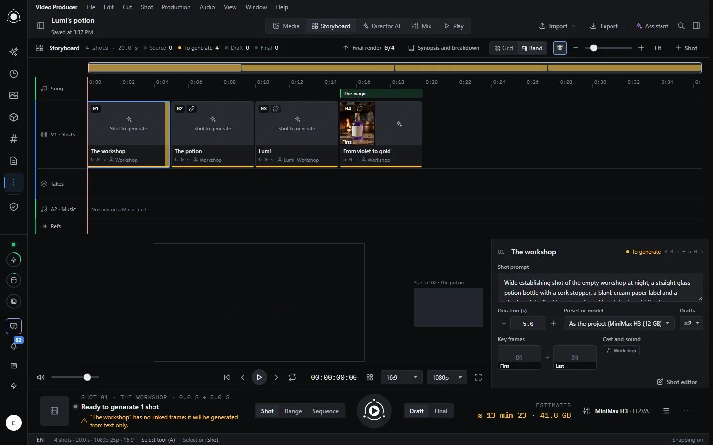
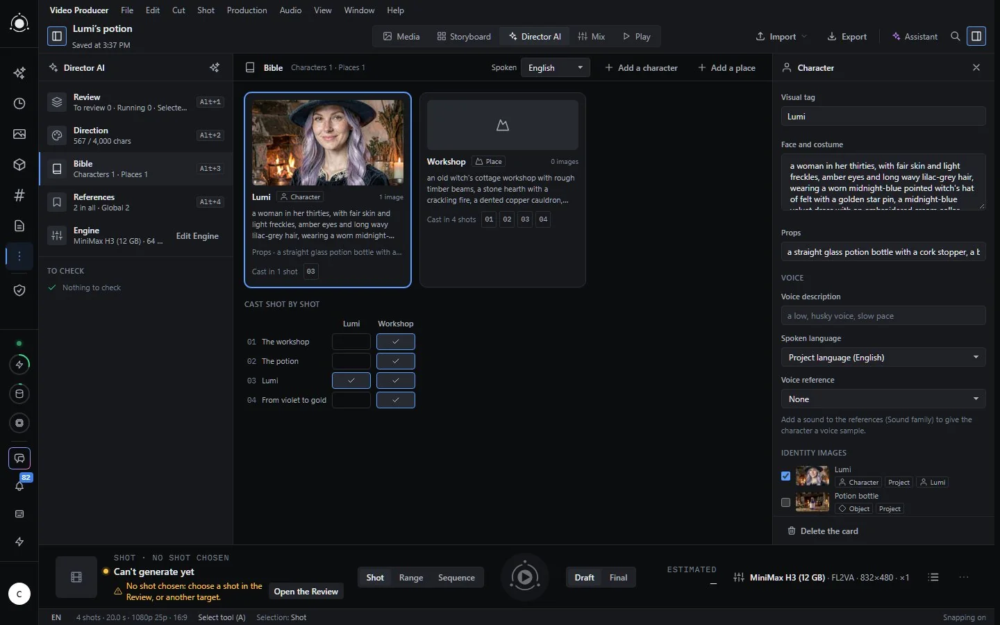
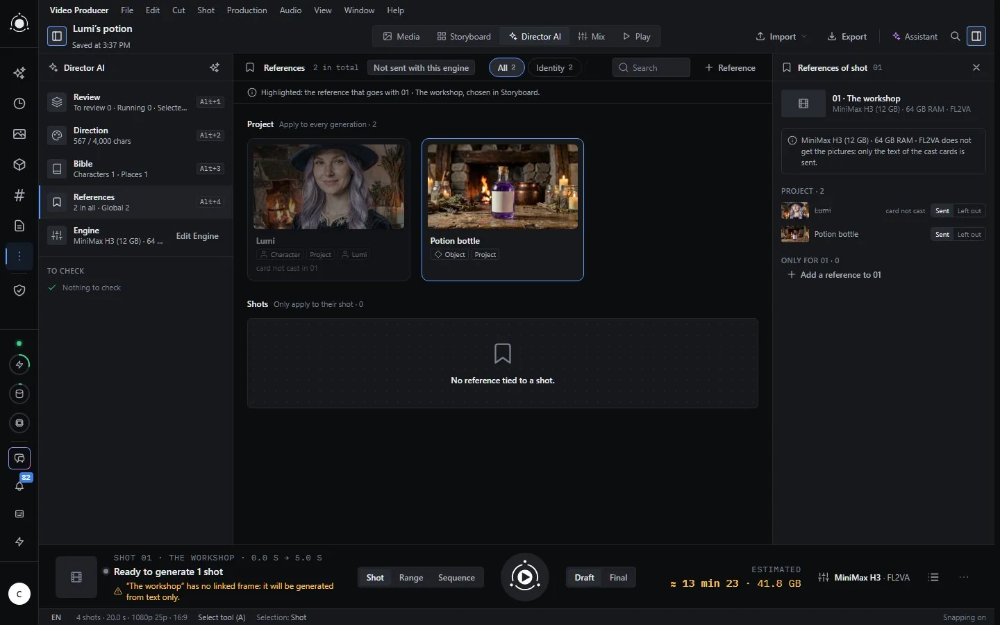
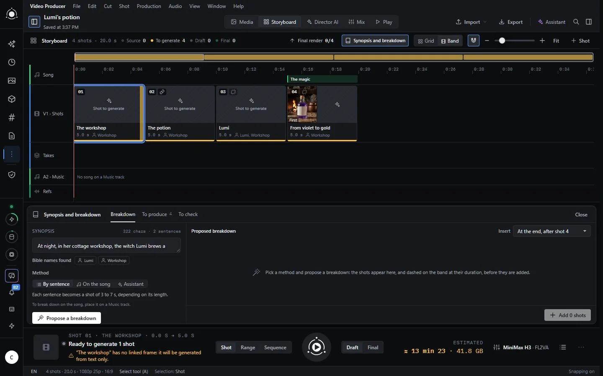
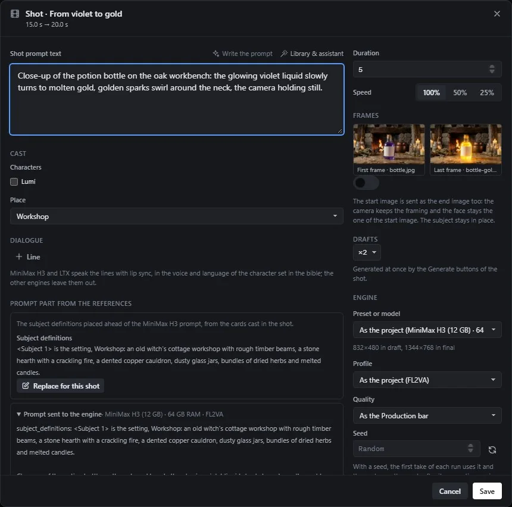
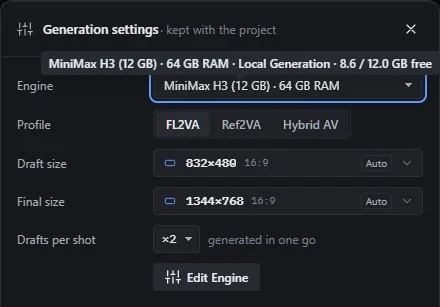
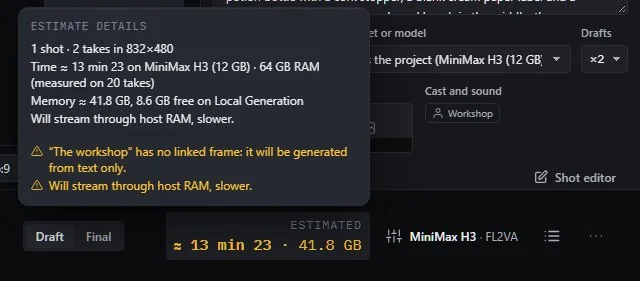
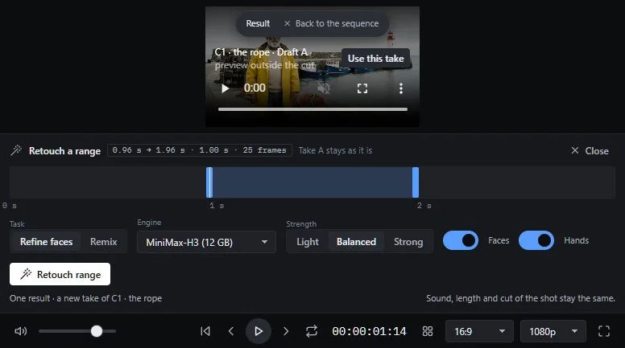
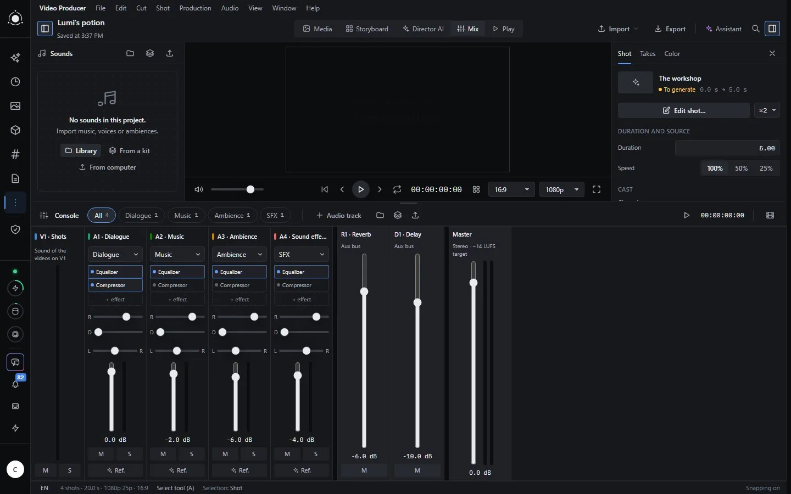
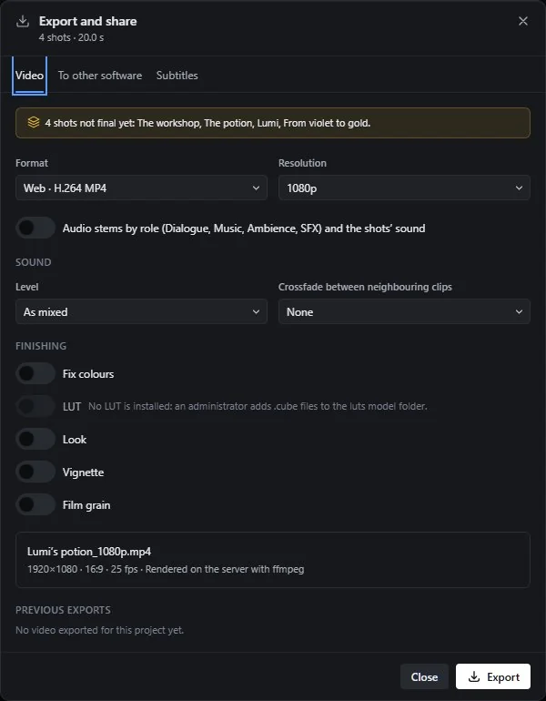

# Video Producer: user guide

This guide takes you through a short film with Video Producer, from the starter project to the exported video. Interface labels are written in **bold**. Every button, panel and message is described in full in **Video Producer: complete reference**, also in the **Documentation** page of PotionUI. In PotionUI, each screenshot of this guide shows as a link to the picture, and the contents and the links to the reference are plain text: open the reference from the list of the **Documentation** page.

## Contents

- [1. Before you start](user-guide.md#1-before-you-start)
- [2. The screen](user-guide.md#2-the-screen)
- [3. Your projects](user-guide.md#3-your-projects)
- [4. Bring in media](user-guide.md#4-bring-in-media)
- [5. Direction, bible and references](user-guide.md#5-direction-bible-and-references)
- [6. Split the film into shots](user-guide.md#6-split-the-film-into-shots)
- [7. Shape each shot](user-guide.md#7-shape-each-shot)
- [8. Generate drafts](user-guide.md#8-generate-drafts)
- [9. Choose the takes and render them in final](user-guide.md#9-choose-the-takes-and-render-them-in-final)
- [10. Continuity and color](user-guide.md#10-continuity-and-color)
- [11. Sound and mix](user-guide.md#11-sound-and-mix)
- [12. Export](user-guide.md#12-export)
- [13. The assistant](user-guide.md#13-the-assistant)
- [14. Language and shortcuts](user-guide.md#14-language-and-shortcuts)
- [15. Troubleshooting](user-guide.md#15-troubleshooting)

## 1. Before you start

Video Producer is a page of PotionUI for making short films with AI video. You write a synopsis and split it into shots. For each shot, you generate quick draft takes, keep the best one and render it in final quality. Then you cut, match the colors, mix the sound and export the film. Open it from the **Video Producer** entry in the sidebar.

Your PotionUI administrator prepares what the page runs on. Ask them if something below is missing:

- **An engine and a video preset assigned to you.** The engine is what makes the videos: a video preset on your administrator's machines, or a cloud model; a preset is a ready-made setup of a model, which your administrator installs and assigns to you. If the engine chip of the production deck reads "No engine", nothing is set up for you yet.
- **The right preset for the card.** A preset whose name ends with a card size, such as **(12 GB)**, is made for a graphics card of that size: **Wan 2.1 T2V 1.3B (8 GB)** or **Wan 2.2 TI2V 5B (8 GB)** on 8 GB; **MiniMax H3 (12 GB)**, **MiniMax H3 Fast (12 GB)** or **Wan 2.2 14B Lightning (12 GB)** on 12 GB.
- **ffmpeg on the server**, to export a video and to start a shot from the last image of the previous one.
- **An upscaler** (SeedVR2 or RTX Upscale) for final renders by upscale, and **an interpolator** (Video Tools or RTX Upscale) so that slow takes play smoothly.
- **A language model**, for the assistant and **Write the prompt**. Everything else works without it.

Generation is real and takes time: on a 12 GB graphics card, count several minutes for a 5-second draft, and hours for a final render by SeedVR2 upscale to 1080p.

**MiniMax H3 and its license.** The **MiniMax H3** engines use a model published under the MiniMax H3 Community License. The license says that use of the model, and of what it generates, in the European Union, the United Kingdom, the United States and South Korea needs an individual authorization from MiniMax (https://platform.minimax.io/h3-license), and that a commercial product must display "MiniMax H3" prominently. Video Producer does not check this.

**The starter project.** The first time you open the page, it creates "Lumi’s potion" and opens it: the witch Lumi brews a violet potion in her workshop and turns it to gold. Its four shots of 5 seconds are still to generate, and each one shows a feature of the page:

1. **The workshop** is made from its text alone.
2. **The potion** starts from the last image of shot 1 (chapter 10).
3. **Lumi** casts the card of Lumi, with her picture, and the card of the workshop (chapter 5).
4. **From violet to gold** goes from a first image, the violet bottle, to a last image, the same bottle turned to gold.

It also holds a synopsis, a global direction, a title, a marker and four empty audio tracks; its three images are added to your media and your PotionUI library. Every engine can generate every shot, and the estimate tells you what each one leaves out. On your next visits, the page opens the project you used last.

**Your first take.** Select shot 1 of "Lumi’s potion", keep **Draft** in the production deck at the bottom and press the round **Generate selection** button (Ctrl+G). **Help › Getting started** lists the steps of a first film as a list you can click; chapters 2 to 12 explain each of them.

## 2. The screen

From top to bottom:

- **The menu bar**: ten menus. **Search commands…** (Ctrl+K) finds any command by name and runs it.
- **The project bar**: the side panel button, the project name and its save state, the five workspaces (**Media**, **Storyboard**, **Director AI**, **Mix**, **Play**), then **Import**, **Export**, **Assistant**, the command search and the Inspector button.
- **The work area**: a left panel that changes with the workspace, the center, and the **Inspector**, which shows the settings of what you selected.
- **The timeline**: **Titles**, **Prompts**, **Frames**, the video track **V1**, the reference video tracks and the audio tracks (**A1**, **A2**…). Drag a shot to move it, its edges to trim it, and the white handles at the top of a clip to set its fades. In the band view of the Storyboard, shown above, the band takes the place of the timeline; Director AI has none.
- **The production deck**, in **Storyboard** and **Director AI**: it says what the next generation will make and holds the one main button of the page, **Generate selection** (chapter 8).
- **The status bar**: the language, the shots and the length of the film, the selection, the takes in the queue and, if your administrator set a limit, your **GPU quota**.

A rule to remember: the Storyboard, the Inspector and Director AI only choose what to generate. The production deck is where you generate.

For a shot, the Inspector has three tabs: **Shot** (**Edit shot…**, duration, frames, fades, sound, cast, dialogue, flag), **Takes** (chapter 9) and **Color** (chapter 10). With nothing selected, it shows the project and **Project properties…**. **Play** shows the cut in a large viewer, without side panels.

Under 1280 pixels of window width, the left panel and the Inspector become drawers: open them with the first and the last buttons of the project bar. Under 640 pixels, the page asks for a wider window.

## 3. Your projects

Your projects are saved on the PotionUI server, in your account, as you work. There is no file to keep.

- **Saving.** The page saves by itself, less than a second after your last change. The project bar reads "Saved at" and the time, "Modified · click to save", "Saving…" or "Not saved — retry". Click the state, or press Ctrl+S, to save at once.
- **New and open.** **File › New project** creates an empty project. **File › Open…** (Ctrl+O) lists your projects, the most recently modified first; its trash icon deletes a project after a confirmation, and keeps its media and the videos of its takes.
- **Properties.** **File › Project properties…** sets the name, the film format (for example 16:9 or 2.39:1), the delivery resolution (720p to 4K) and the frame rate.
- **Versions.** Each save creates a version. **File › Version history…** lists them, and **Restore** goes back to one. A restore is a new version, so you can come back from it; your administrator sets how many versions are kept (50 by default).
- **Undo.** **Edit › Undo** (Ctrl+Z) and **Redo** (Ctrl+Shift+Z or Ctrl+Y) work on up to 100 steps. Opening another project or reloading the page empties the history.

If the same project is open in two tabs, or the assistant changes it while you work, the page merges both sides; when both changed the same thing, your version wins, and Ctrl+Z undoes the merge.

## 4. Bring in media

The **Media** workspace lists the images, videos and audio files of the project, and its takes. Filter them, double-click one to preview it, and drag it to the timeline. Bring media in:

- **From the library**: **File › Import from the library…** (Ctrl+I), or the **Library** buttons.
- **From the gallery**: **File › From the PotionUI gallery**, your past generations.
- **From a kit**, on a PotionUI that has kits: the **From a kit** buttons next to **Library**, then one item, several, or **Use whole kit**.
- **From this computer**: **File › Import from this computer…** (Ctrl+Alt+I, ⌃⌘I on a Mac), the **From computer** buttons, or drop files on the Media panel or the timeline. Each file goes to your PotionUI library first.

An imported media is a link to its file in your library or gallery: if you delete that file from PotionUI, the viewer says **Media offline**. The trash icon of a media removes it from the project; the file stays in your library.

**Import a cut as shots.** To start from an existing edit, an animatic or a reference film, choose **File › Import a cut as shots…**, pick the video, set **Sensitivity** and **Shortest shot**, choose what **Each piece becomes** (**The shot's source**, or **Its motion reference** for MiniMax H3 in the Ref2VA profile, chapter 8) and where to **Place the shots**, then click **Find cuts**. Video Producer makes one shot per cut; one **Undo** removes them all.

## 5. Direction, bible and references

**Director AI** has four views: **Review**, **Direction**, **Bible** and **References** (Alt+1 to Alt+4). Its left panel sums them up and lists, under **To check**, the conflicts with the direction, the cards a shot names without casting them, the failed takes and the seams to fix (the cuts between two shots, chapter 10).

- **Direction** holds the five fields of the global direction: world and intent, characters and identity, photography, palette and lighting, pacing and continuity. This text guides every shot. **Composed prompt**, on the right, shows the prompt a sample shot would send, and an alert lists the shot prompts that contradict the direction.
- **Bible** holds one card per recurring character and one per place.
- **References** holds the pictures, videos and sounds that guide the generation, for every shot (**Project**) or for one shot. The panel on the right says what each engine really gets of a reference.

A card has a **Visual tag**, short and concrete ("the red-haired woman in the navy raincoat"), a fixed description and its **Identity images**; a character card can also hold a **Voice description**, a **Spoken language** and a **Voice reference**. Cast a card in a shot (shot editor, Inspector or **Cast shot by shot**): its words then go into the prompt of that shot. Write the visual tag of each cast character in the shot prompt; the page warns you when it is missing.

Text alone does not hold a face from shot to shot: a consistent first frame, or Ref2VA references, work better. Only the Ref2VA profile sends the reference pictures to the engine: MiniMax H3 receives them directly, LTX-2.5 on one reference sheet. The other engines and profiles receive the words of the cards.

## 6. Split the film into shots

The **Storyboard** has two views, chosen in its header:

- **Band** shows each shot as a block as wide as its duration, with its takes, the music and what it sends to its engine under it. A marker between two shots shows the seam: green when it matches, orange when it needs a look. Drag a shot to move it, its right edge to change its duration. Under the band, the **monitor** plays the cut, and the **quick edit** changes the name, prompt, duration and engine of the selected shot.
- **Grid** shows one card per shot, with its stage (**Source**, **To generate**, **Draft** or **Final**), its takes and its prompt. An orange alert on a card means the shot does not match the previous one (chapter 10).

**Synopsis and breakdown** (D, or its button in the header of the band) opens a window under the band, or the left panel in the grid:

- **Breakdown**: write your synopsis, pick a method, then click **Propose a breakdown** (**Ask the assistant** with the Assistant method). **By sentence** makes one shot per sentence, **On the song** follows the parts of a song on a Music track, **Assistant** asks the PotionUI assistant. Keep, rename, split, merge, move or remove the proposed shots, then click **Add N shots**.
- **To produce**: the drafts left to make and the shots to render in final, with **Generate their drafts**.
- **To check**: the seams to fix, the failed takes, the shots whose prompt changed after their takes and the shots without a prompt.

Ctrl+click a shot (⌘+click on a Mac) to add it to the selection, and Shift+click to pick every shot between two. Ctrl+G then queues all of them, Delete deletes them in one step, and Esc clears the selection.

## 7. Shape each shot

**Edit** on a card, **Edit shot…** in the Inspector, a double click on a block of the band, or E, opens the shot editor. It gathers what a take of the shot is made from.

- **Shot prompt text**: what happens in the shot, in English (chapter 14).
- **Cast**: the characters and the place of the shot, from the bible. **Prompt sent to the engine** shows the whole prompt the shot will send.
- **Dialogue**: the lines, each with its **Speaker**. MiniMax H3 and LTX speak them with the mouth in sync; Wan and the cloud models leave them out.
- **Frames**: the **First frame** and the **Last frame** of the take. An image in another shape than the take is cropped at its centre, and the pictures show what stays. **Keep the framing** sends the first frame as the last one too.
- **References**: the project references the shot sends (**Exclude** leaves one out) and its own references, sounds included.
- **Start and end images**: an image model makes a first or last frame from the pictures of the shot, or the shots around it give theirs.
- **Drafts**: how many takes one generation of this shot makes, 1 to 8.
- **Engine**: this shot's own engine, profile, quality or seed. **Back to the project** removes them.

**Save** applies everything, and **Edit › Undo** brings it all back. Saving never deletes a take: the takes made before an edit show **Prompt modified**.

**Write the prompt**, above the shot prompt text, has the language model of PotionUI write the prompt from a few words of yours: type them, click **Write** (Ctrl+Enter), then **Use this prompt** or **Discard**. **Undo** gives back your prompt of before. **Library & assistant**, next to a text, opens the prompt library: templates in nine categories, and a **Composer** for camera, lighting, film style and acting.

## 8. Generate drafts

Generation is real: a take is a video made in the background by the engine you picked. You can leave the page while it runs.

The production deck has, from left to right:

- **The state**, with a coloured dot: "Ready to generate 1 shot", **Can't generate yet** (with the reason, and often a button that fixes it), "Generating" with its progress, "2 takes ready", or "Take A failed" (with **Retry**).
- **The target and the button**: **Shot**, **Range** or **Sequence** (or **3 shots** when you picked shots), the round **Generate selection** button (Ctrl+G), and the quality, **Draft** or **Final**. While takes run, the round button cancels them.
- **The tools**: the **Estimated** cell, the engine chip, the generation queue and **More**.

**The engine chip** opens **Generation settings**: the **Engine** (the presets and cloud models your administrator enabled for you), the **Profile** (below), the **Draft size** and **Final size** (**Auto** is a good default), the **Drafts per shot** (1 to 8) and **Edit Engine**, every option of the engine as its preset defines them.

**The estimate.** The **Estimated** cell shows the expected time and, for a local engine, the GPU memory; click it for the details. The time comes from the takes already made on this server with the same preset, at the same size or the closest size measured, so it reads "—" until a first take of that preset is done. Warnings in amber do not block. If your administrator limits your GPU minutes, a generation that would exceed what is left this month is refused, and a take that fails or is cancelled gives its minutes back.

**Generate.**

1. Keep the quality on **Draft**: quick takes at a small size, to judge the motion and the framing. **Final** makes takes at the largest size of the engine; to improve a draft you like, **Final render…** is usually better (chapter 9).
2. Choose the target: select a shot, draw a range on the timeline, choose **Sequence** for the whole film, or pick several shots with Ctrl+click. A shot whose link chip is on starts from the end of the previous shot's take and waits for it: generate the two in order, or together (**Sequence**, a range, or both shots picked) (chapter 10).
3. Press **Generate selection** or Ctrl+G.

Each shot gets as many takes as its number of drafts, each with its own seed. Press Ctrl+G again while takes run, and the new takes join the queue. The deck, the Storyboard card and the block of the shot show the progress; when a batch ends, a message offers **View**, and PotionUI sends a notification for each take that is ready or failed. The list button of the deck (Ctrl+Alt+G) opens the generation queue, which all your projects share. Your administrator limits how many of your takes run at once: the others wait as **Queued**.

**Profiles.** The profile says what guides the generation; **FL2VA** is the default, and the page greys the profiles the engine cannot run.

| Profile | What guides the take | Engines |
|---|---|---|
| FL2VA | The first and last frames of the shot, and its text. A shot without a frame is made from its text alone. | All engines. |
| Ref2VA | The references: pictures of characters, places and objects, motion videos and sounds. Up to 9 images, 3 videos and 3 sounds per shot. | MiniMax H3 and MiniMax H3 (12 GB); LTX-2.5 through a reference sheet, once your administrator installed it. |
| Hybrid AV | Like FL2VA; the model makes the picture and the sound together. | MiniMax H3 and its variants. |

LTX-2.5 is published under the LTX-2.x Community License of Lightricks, which asks that a video it generates be said to be generated by AI where the law requires it.

**Reference video tracks** give MiniMax H3 a video to follow in Ref2VA: see chapter 8 of the reference, [Reference video tracks](user-reference.md#reference-video-tracks).

## 9. Choose the takes and render them in final

A take is one generated video for one shot; it stays in your generation history even if you delete it here. Compare the takes in the **Review** view of Director AI, or in the **Takes** tab of the Inspector. Click a take to play it; the panel on the right shows the prompt it received, or why it failed and what to do.

A take is **Selected** when it is the one its shot plays, and of **Final** quality when it was made at full resolution. A selected take can be a draft.

- **Labels**: **Draft** (new), **Candidate** (worth keeping), **Rejected** (hidden by **Hide the rejected takes**, not deleted) and **Selected** (one per shot). Click **Candidate**, **Reject** or **Selected** under a take card to label it. The first draft that finishes for a shot without a take is selected for you, and so is a finished final render.
- **The take card** shows the letter, the quality, the engine, the label and the state. A failed take explains the cause in plain words, with **Retry**. The card also offers **Take details**, **Compare**, **Extract a frame at the playhead** (chapter 10), **Generation details** and **Delete**.
- **Assemble chosen takes**, at the bottom of the **Review**, puts every selected take in the cut.

**Retouch a range** fixes part of a finished take instead of the whole shot, with the 12 GB MiniMax H3 presets. Open it from the wand of a take card, or with **Shot › Retouch a range of the take…**. Mark the range with its handles or with **I** and **O**, choose **Refine faces** (the faces, the hands or both) or **Remix** (1 to 3 seconds, from a change written in English), and click **Retouch range**. The result is a new take of the same shot, with the same length and sound; **Compare with** and the letter of the original take, on its card, shows both takes side by side. See chapter 9 of the reference, [Retouching a range of a take](user-reference.md#retouching-a-range-of-a-take).

**Final render…** on a draft offers:

- **Upscale** (the default), which enlarges the take as it is, without changing the motion. The **Upscaler** is **Automatic**, **Fast (RTX)** (seconds, sharp, adds no detail), **SeedVR2** (slow, restores detail) or, for a take of the base MiniMax H3 preset, **Engine**; **Auto**, as **Target resolution**, gives the size the film needs.
- **Re-render at full resolution**, which generates the shot again at the largest size with the same seed: the subject and the look stay, the layout of the picture changes.
- **Guided render**, when your administrator installed it, which renders the shot again with LTX-2.5, following the motion and framing of the take.

Without an upscaler assigned to you, the window shows **Upscaler not available** and offers the re-render, and the guided render when it is installed. Once every shot has a selected take, **Production › Final render of the film…** renders all of them at once.

**Frame rate and slow motion.** A take keeps the frame rate of its engine (16 fps for Wan 2.1 and Wan 2.2 14B, 24 fps for Wan 2.2 TI2V 5B (8 GB) and MiniMax H3, 25 fps for LTX); a take much slower than the film stutters in the export. **Conform**, offered by the **Export** window, **Final render of the film** and **Final render…**, makes a version at the frame rate of the film; it needs **Video Tools** or **RTX Upscale** assigned to you. **Speed**, in the Inspector and the shot editor, slows a take down: see chapter 9 of the reference, [Slow motion](user-reference.md#slow-motion).

## 10. Continuity and color

Video Producer measures every seam, the cut from one shot to the next, and warns when two neighbor shots do not match.

- **Color.** An alert says that a shot is brighter, darker, warmer or cooler than the previous one. **Match** (**Match color** in the Storyboard) fixes it; **Match colors (n)** fixes every seam at once. The **Color** tab of the Inspector has presets, fine settings and **Auto match**, which corrects a take from an **Anchor** image.
- **Look.** The server compares the overall look of the takes at each seam and with the pictures of the bible. It is not a face recognition. Under a threshold, the page says "Look to check" or "drifts from the card", and **Compare the takes** shows them side by side.

**Start a shot from the previous shot.** With the FL2VA profile, a take starts on the first frame of its shot: give it the last image of the previous shot, and the two shots join without a jump.

- **Use the previous shot’s last frame**, on the alerts, in the seam panel and in the Inspector, sets that image as the **First frame** of the shot.
- A shot you add after another starts from its last image by itself (**Start each new shot from the previous one**, in **File › Project properties…**).
- **The link chip** next to the number of a shot switches whether it starts from the end of the previous one. A chained take waits for the take of the previous shot, and fails if that one fails.
- **Chain by**: **Last frame** (the default), or **Continuation**, which sends the last 2.33 seconds of the previous take to MiniMax H3: its motion in Ref2VA, its motion and sound with the two 12 GB MiniMax H3 presets in FL2VA.

**Wan 2.1 T2V 1.3B (8 GB)** generates from text only and does not use first frames. **Wan 2.2 14B Lightning (12 GB)** hands a shot that starts from an image to its image-to-video companion, when your administrator installed it.

**Extract a frame at the playhead**, on a finished take, makes the image under the playhead the **First frame** of the shot, or its **Last frame** in the second half of the shot.

**Cross-dissolve.** Select the shot that starts and choose its **Transition** in the Inspector: **Cut**, or a **Cross-dissolve**. No frame is generated for it: the shot that starts moves earlier, so the film gets shorter by the length of the dissolve, and the page says by how much. Its lengths and limits are in chapter 12 of the reference, [Cross-dissolve between two shots](user-reference.md#cross-dissolve-between-two-shots).

## 11. Sound and mix

Audio lives in tracks, each with a role: **Dialogue**, **Music**, **Ambience** or **SFX**. **Audio › Add audio track** adds one; the **Audio** menu imports sounds, and you can drop audio files on a track. To delete a track, select it and press Delete.

- **The mixing console**, in **Mix**: for each track a fader (double-click it for 0 dB), pan, **Equalizer**, **Compressor**, **Filter**, reverb and delay sends, and a meter. What you hear is what the exported video holds.
- **Mute and solo**: **M** and **S**, on the timeline and in the console, **V1** included for the sound of the shots. Mute wins over solo. **Mute this shot**, in the Inspector, mutes one shot.

**Sound that goes with the generation.** A shot can send sound references (Director AI › References, family **Sound**, or **Add a sound** in the shot editor) and **Reference tracks** (an audio track switched to **Reference for the generation**: the part under the shot goes with it). The shot editor, the Storyboard card and the estimate say what the engine does with it:

| Engine | What happens |
|---|---|
| MiniMax H3 with Ref2VA | The sound guides the generation. A shot needs a picture or a video besides its sound. |
| LTX, and MiniMax H3 outside Ref2VA | The sound is mixed onto the finished take, without guiding the picture. |
| Wan, cloud models and the other engines | Nothing is sent; the sound stays in your edit. |

To send only part of a long sound, select the clip and use **Slice** in its Inspector (Ctrl+Shift+B), or **Slice on the shots**; **Join** (Ctrl+Alt+B) puts the slices back together.

## 12. Export

**File › Export video…** (Ctrl+E) opens **Export and share**, with three tabs: **Video**, **To other software** and **Subtitles**. The window first warns about shots not in final quality, rejected takes and direction conflicts. The export always renders the whole film.

- **Video**: **Web · H.264 MP4** in the aspect ratio of the project, **Social media · H.264** in 9:16, 4:5 or 1:1 (cropped around the center), **Master file · ProRes 422 HQ** or **Archive · H.265 10-bit**, from 720p to 4K. Options: **Audio stems by role**, **Level** and **Crossfade between neighbouring clips**.
- **Finishing**, for a web or social video: **Fix colours**, a **LUT**, one of your looks (**Look**), a **Vignette** and **Film grain**, all off by default. The finished video is a second file in your library; the plain export is always kept.
- **To other software**: **FCPXML**, **OpenTimelineIO** and **EDL CMX 3600** files of the cut, with the order, names and in points of the shots, but no fades, colors or titles. They point to the media as the server stores them: if your editing software runs on another computer, copy your takes there and relink them.
- **Subtitles**: an SRT file made from the titles of the timeline. Subtitles are never burned into the video.

The video holds the shots with their color and fades, and the sound as the console plays it; titles and markers are not in it. The export runs in the background: you can close the window or leave the page. Its card offers **Download** when it is ready, and a web or social video is also copied to your library. Your administrator sets a size budget for your exports; when it is full, your oldest exports are deleted.

## 13. The assistant

The assistant is the PotionUI chat in its **Video Producer assistant** mode. It reads your project and can write and fix shot prompts, cut your synopsis into shots, add, change, order and delete shots, check the continuity, generate takes, label them, assemble the edit and export the video.

- **What costs or cannot be taken back waits for you**: rewriting a prompt, deleting shots, generating takes and proposing a breakdown show a card, and nothing happens until you click its button: **Approve**, or **Run** for takes to generate.
- **The rest is done at once.** Ctrl+Z takes back what it changes in the project, a take put on its shot included, but not an export or a label that puts no take on a shot.

Open it with **Assistant** in the project bar, **Window › PotionUI assistant**, or Ctrl+J, and keep the page open on your project while you chat. A conversation started elsewhere in PotionUI keeps its own mode: click **start a new chat** from this page. Write in your own language, and select a shot first or name it:

- "Write the prompt of the shot “The gulls”: a low angle on the water, backlit."
- "Cut my synopsis into shots of about 5 seconds."
- "Generate a draft of shots 1 to 3." A card shows the takes, the engine, the GPU minutes and the time.

It does not edit the synopsis, the direction, the cards, the titles, the color or the sound, choose the engine, render the film in final or import media: it answers in text, and you do it on the page. Each of its changes is a version marked "Assistant" in **File › Version history…**.

## 14. Language and shortcuts

Choose the language of the interface in **Video Producer › Preferences…**, or click the language reminder at the left of the status bar. Until you choose, the page follows your browser. Your own texts never change language.

**Write your prompts in English.** Every prompt is in English, including what the page or the assistant writes for you, and the checks that compare a shot prompt with the direction only read English. A prompt in another language is sent as you wrote it.

The shortcuts you use most, for Windows and Linux (on a Mac, read ⌘ for Ctrl and ⌥ for Alt; the menus and tooltips show the keys of your system):

| Shortcut | Action |
|---|---|
| Ctrl+K | Search commands… |
| Ctrl+/ | Keyboard shortcuts (the whole list) |
| Ctrl+Z, Ctrl+Shift+Z | Undo, Redo |
| Ctrl+S | Save |
| Ctrl+G | Generate selection |
| Ctrl+Alt+G | Generation queue |
| Ctrl+E | Export video… |
| Ctrl+J | PotionUI assistant |
| Alt+1, Alt+2, Alt+3, Alt+4 | The views of Director AI |
| Space | Play / pause |
| D, E | Synopsis and breakdown, Shot editor |
| Esc | Close what is open, then clear the selection |

The single-letter shortcuts can be turned off in **Video Producer › Preferences…** (**Single-key shortcuts**). Most shortcuts act only while the focus is not in a text field. The complete table, and when each shortcut works: [16. Keyboard shortcuts](user-reference.md#16-keyboard-shortcuts) in the reference.

## 15. Troubleshooting

- **The engine chip reads "No engine".** Your administrator has not finished the setup for you. Ask them.
- **The round button is disabled.** Read the reason of the deck (**Can't generate yet**) and use the button it offers.
- **"Models to install for this preset: …".** The server lacks model files for that preset. Ask your administrator.
- **"Will stream through host RAM, slower."** The model does not fit in the memory of the graphics card. The generation still runs, more slowly.
- **A take failed.** Its card explains the cause. If the graphics card ran out of memory, try a draft, a shorter shot or another engine, then **Retry**. If every take then fails within seconds, ask your administrator to restart the backend.
- **"Upscaler not available"** or **the export repeats frames.** No upscaler, or no interpolator, is assigned to you. Ask your administrator.
- **"ffmpeg is missing on the server".** No video can be made until your administrator installs it. The files for other software and the subtitles still work.
- **"Chat is currently unavailable".** No language model is assigned to you: ask your administrator.

Every other message, with its cause, is in the reference: [17. Troubleshooting](user-reference.md#17-troubleshooting). The words of the page are explained in its [18. Glossary](user-reference.md#18-glossary).
